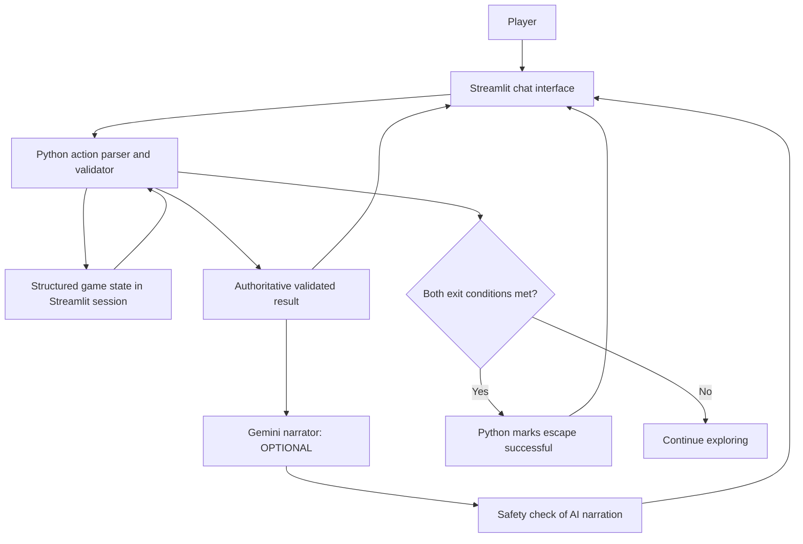

# AI Escape Room — Version 2: Reliable Locked Library

Version 2 is an improvement to the **same game** from Version 1. This release uses **the same Editorial Minimal visual style as Version 1** (paper background, archive index sidebar, book-like headings, minimalist victory page). The player explores a mysterious library (desk, bookshelf, painting, clock, drawer, exit door), solves a drawer-code puzzle, collects a brass key, and solves a final four-digit exit keypad.

**Big change:** In Version 1, Gemini decided whether actions worked based on chat history. In Version 2, **Python validates every action and maintains the real game state**. Gemini can describe only what Python has already approved.

## What changed?

| Aspect | Version 1 | Version 2 |
|---|---|---|
| Game memory | Conversation history | Structured Python dictionary in `st.session_state` |
| Code checking | AI interpretation | Python checks exact lock combinations |
| Inventory | AI may assume the key was collected | Python stores the actual collected items |
| Victory | AI returns a special victory marker | Python allows victory only if key AND exit code are validated |
| Invalid actions | May be handled inconsistently | Deterministic rejection of nonexistent objects, wrong codes, false claims |
| AI responsibilities | Narration + rules | Short optional narration of *validated* events only |
| API outage | May interrupt gameplay | Game still works using Python results |

## Architecture (Version 2)



**Trust boundary:** The player's free-form text is processed by the Python engine, **not forwarded directly to Gemini**. Gemini receives only an already-validated event. The game displays Python's authoritative result independently of the AI narration. The AI cannot change inventory, puzzle solutions, or `escaped`.

## Folder contents

- `app.py`: Streamlit interface, editorial layout and session persistence
- `theme.css`: matching Version 1 style with Version 2 state indicators
- `.streamlit/config.toml`: matching Version 1 color theme
- `THEME_GUIDE.md`: design overview
- `engine.py`: room state, command interpretation, validation, completion rules
- `game_config.py`: fixed game settings, puzzle answers, safe narrator prompt
- `narrator.py`: optional Gemini storytelling and output sanity checks
- `tests/test_engine.py`: automated edge-case tests, no API key needed
- `test_cases.md`: test descriptions and expected outcomes
- `screenshots/`: add your own screenshots after running the application
- `requirements.txt`: Python libraries
- `.env.example`: safe key template (never use real credentials here)
- `.gitignore`: excludes `.env` and temporary files

## How to run (Windows PowerShell)

1. Open the `version2` folder in VS Code or use `cd version2` in the terminal.
2. Install packages:
   ```powershell
   python -m pip install -r requirements.txt
   ```
3. Copy your **existing local Version 1** `.env` file into `version2`, or create one:
   ```powershell
   Copy-Item .env.example .env
   ```
4. Edit `version2/.env` and enter your actual `GEMINI_API_KEY`. Use the same `GEMINI_MODEL` that worked for Version 1. Never upload the `.env` file.
5. If Version 1 is still running, stop its terminal with `Ctrl + C`, or choose a different port when starting Version 2.
6. Start Version 2:
   ```powershell
   python -m streamlit run app.py
   ```
7. Open the URL shown in the terminal, typically <http://localhost:8501>.

**Note:** With no API key, the reliable Python game remains playable, but the optional Gemini atmospheric narration will not appear.

## Example normal playthrough

Enter these natural-language actions in the chat:

1. `Examine the desk`
2. `Examine the bookshelf`
3. `Enter 274 on the drawer`
4. `Pick up the brass key`
5. `Examine the painting`
6. `Look at the clock`
7. `Use the brass key on the exit door and enter 0835`

You will see a **SUCCESS** message and a victory banner. The sidebar shows inventory, drawer state, and exit progress directly from Python.

## Test the rules automatically

No Gemini key, internet connection, or live Streamlit session is needed for the rule tests.

```powershell
python -m unittest discover -s tests -v
```

The tests cover the normal escape, incorrect drawer code, uncollected key, wrong door code, administrator impersonation, falsely claiming completed puzzles, asking for secret codes, invented objects, order of puzzles, reliable memory, restart, and fake AI victory.

Record screenshots of (1) initial room, (2) collected key in sidebar, (3) rejected incorrect code, (4) rejected administrator instruction, and (5) successful escape. These are not bundled until you capture them locally.

## Known limitations / future work

- The player-language parser recognizes a useful set of natural English phrases but does not understand every possible paraphrase. Unrecognized actions fail safely rather than changing game state.
- State persists only during a Streamlit session; it is not stored in a database.
- Gemini can still generate inaccurate atmospheric text. The app applies basic text checks and always shows Python's authoritative outcome; further output constraints could be added.
- Codes are hard-coded in a private Python config for this demonstration and visible in a public source repository. That is appropriate for reproducible class projects, but players wanting an unspoiled experience should not read source code first.

## Security

Keep your real Gemini key only in local `.env`, which is excluded by `.gitignore`. Check `git status` before committing. Do not publish screenshots showing keys or account information.


## Common Windows troubleshooting

If PowerShell says **`py` is not recognized**, use `python` in the commands above. If `python` is also unavailable, install Python and enable its PATH option; restart VS Code.

If `requirements.txt` is missing, run `dir` and `cd version2` to move into the directory that contains `app.py` and `requirements.txt`.

If port 8501 is occupied, stop the previous Streamlit server with **Ctrl+C** or run:

```powershell
python -m streamlit run app.py --server.port 8502
```

Never add your real `.env` to GitHub. The game still plays without an API key, using Python-only text.
