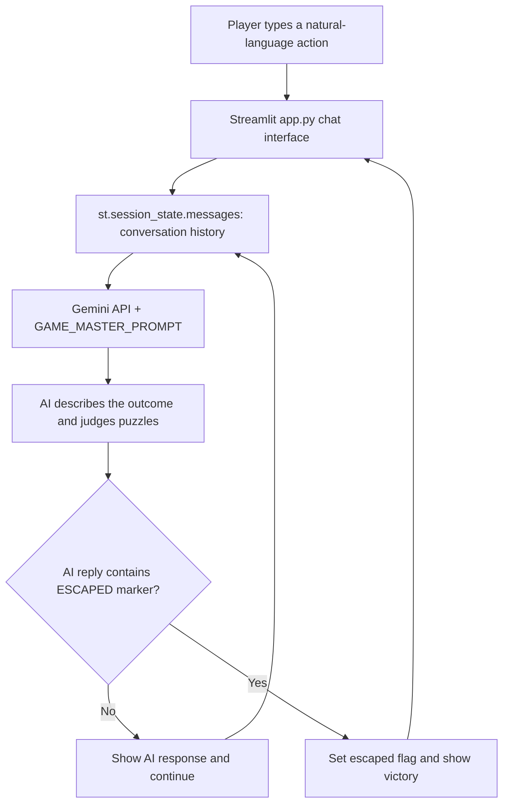
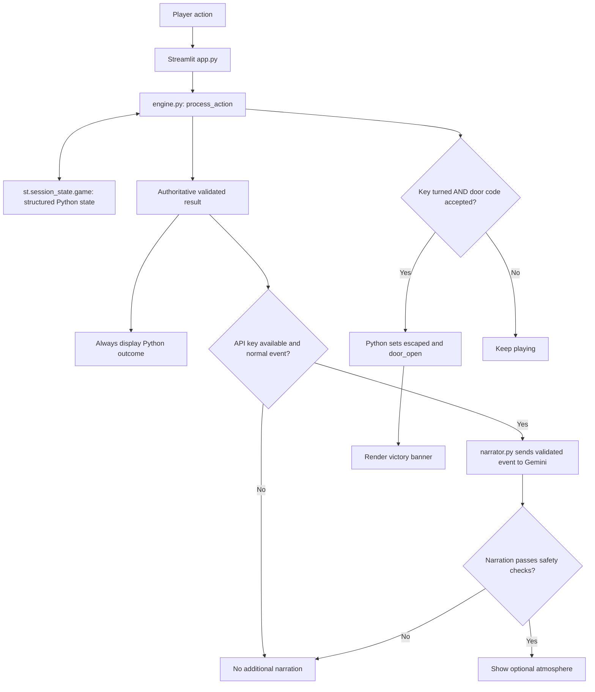

# AI Escape Room — Architecture of Version 1 and Version 2

These diagrams describe the implemented **The Locked Library** game. GitHub renders them automatically because they use Mermaid syntax.

## Version 1 — AI acts as both Game Master and rule checker

**Files:** `version1/app.py` runs the interface and Gemini request; `version1/game_config.py` contains the story, objects and rules.

**What is risky?** The model is asked to remember the collected key, validate the codes and declare victory from the chat. There is no separate Python inventory or action validator. This makes the implementation simple, but it can be inconsistent if the AI misreads the conversation.

## Version 2 — Python controls facts; Gemini provides optional atmosphere

**Files and responsibilities**

| Component | Responsibility |
|---|---|
| `version2/app.py` | Streamlit interface, Dark Mystery page, sidebar, chat and restart |
| `version2/engine.py` | Interpret supported player actions; enforce inventory, combinations and escape requirements |
| `version2/game_config.py` | Fixed room objects, puzzle codes, prompts and story text |
| `version2/narrator.py` | Optional Gemini narration of events already approved by Python; reject obvious contradictory output |
| `version2/assets/theme.css` | Antique-gold and dark-library visual styling only |
| `version2/.streamlit/config.toml` | Default Streamlit theme settings |
| `version2/tests/test_engine.py` | Automated Python engine and narration-safety tests |

**Structured state:** `new_game_state()` creates a Python dictionary with `objects`, `clues_seen`, `inventory`, `puzzles_solved`, `drawer_open`, `key_turned`, `door_code_accepted`, `door_open`, `escaped` and an action counter. The UI stores it in Streamlit session state.

**Winning rule:** The drawer unlocks only with the three-digit combination `274`; the player then must **explicitly collect** the brass key. The exit opens only when Python has accepted code `0835` and the player has used the collected key. The order of the two final unlock actions does not matter.

**Trust boundary:** Version 2 processes the player's raw command in `engine.py`, not in Gemini. Gemini receives the trusted result message only. Its words cannot change inventory, codes or `escaped`. If AI narration is unavailable or rejected, Python's result is still displayed.

## Summary

- **Version 1:** `Player → Streamlit → Gemini decides → Streamlit shows response`.
- **Version 2:** `Player → Streamlit → Python validates/updates state → Streamlit shows result`, with **optional** AI narration afterwards.

This separation of language generation from game rules is the main design improvement required by the assignment.
